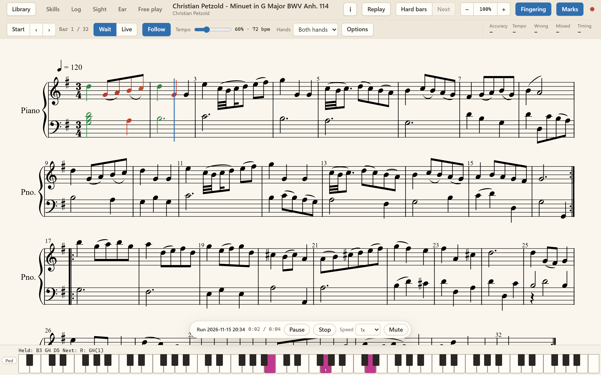
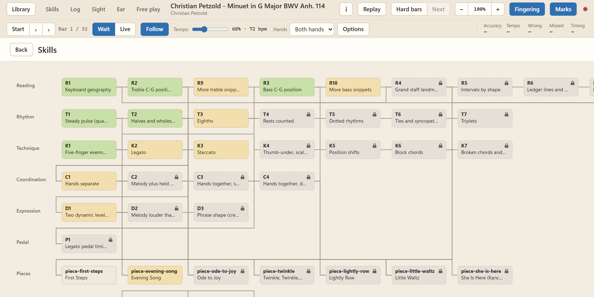
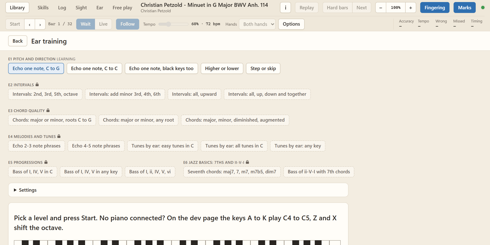
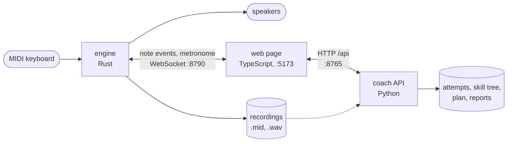

<div align="center">

# rusty_piano

**A piano engine in Rust and a practice coach that actually listens to you play.**




<sub>Replaying a run of Petzold's Minuet in G. Green was right, red was wrong, and the keyboard at the bottom shows what was held.</sub>

[What it does](#what-it-does) · [The engine](#the-engine) · [The coach](#the-coach) · [Running it](#running-it) · [How it's wired](#how-its-wired) · [Status](#status)

</div>

---

I'm learning piano on a Studiologic SL990, which is 88 good keys and no sound at all. It needed something to make the noise, and I needed something to tell me what I'd actually done wrong, since playing alone you just hear that it sounded off.

So I wrote both. The engine turns MIDI into sound with very little delay. The web page shows the sheet music and follows along as I play. The coach saves every attempt, so next time it can tell me *which* bar I keep rushing instead of just giving me a score.

It's built for one beginner (me), but any MIDI keyboard works.

## What it does

<table>
<tr>
<td width="50%" valign="top">

<b>Sheet music that follows you.</b> Open any MusicXML file or grab one from the built-in public-domain library (about 254,000 scores, searchable via <a href="https://zenodo.org/records/15571083">PDMX</a>). <i>Wait</i> mode holds until you hit the right notes; <i>Live</i> mode keeps going and grades your timing.
</td>
<td width="50%" valign="top">

<b>A skill tree with real gates.</b> 77 skills in ten tracks, from reading and rhythm to pedal, scales and ear. The next skill opens after three clean runs spread over at least two days, not one lucky take. <i>Mastered</i> means you can still play it cold after a week away.
</td>
</tr>
<tr>
<td width="50%" valign="top">

<b>A log that doesn't lie.</b> Minutes per day, streaks, every run of every piece, and a replay link for each one.
</td>
<td width="50%" valign="top">

<b>Ear training and sight-reading drills.</b> Ear training goes from "echo one note" all the way to seventh chords and ii-V-I bass lines. Sight-reading goes from five treble notes to two-hand phrases, and shows the notes you miss more often.
</td>
</tr>
</table>


**Free play** just writes down what you play and names the chords. It's handy for noodling, or for finding out what that chord you just found actually is.

### The smaller stuff

- Practice one hand at a time, loop a few bars, and let the **tempo ramp** speed you up a little after every clean pass.
- Fingering suggestions, warnings when you let go of a note too early, and a **Hard bars** button that jumps to where you mess up most.
- Scales and arpeggios in all 12 keys with textbook fingering, graded on how even your notes are.
- Pin a note to any bar, or to the whole piece, so next week you remember what the problem was.
- Every session gets recorded to `.mid` automatically. You can play it back or render it to WAV.
- A metronome, transpose and octave shift. No keyboard plugged in? Keys `A`–`K` on your computer keyboard play C4–C5.

## The engine

The Rust half reads MIDI with `midir` and plays sound through WASAPI shared, WASAPI exclusive, or ASIO.

**How fast is it?** Shared-mode WASAPI gives about 10–20 ms whatever buffer you ask for, which is fine for trying it out. For real playing I use ASIO through [FlexASIO](https://github.com/dechamps/FlexASIO). On my laptop's built-in Realtek speakers that runs clean at a 64-sample buffer, about 1.3 ms.

There are two voices:

- a cheap, clean sine-based piano
- a **physical-model piano**. It's not a sample library: every note is computed as you play.

What the physical model simulates:

| Part | What happens |
|---|---|
| Strings | Stiff strings with slightly sharp overtones, and one to three strings per key tuned a hair apart, so notes beat the way a real unison does. |
| Hammer | A felt hammer that gets stiffer the harder it hits, simulated at 8x the audio rate. Loud notes come out brighter, not just louder. |
| Soundboard | Strings and soundboard push on each other through the bridge, and two virtual microphones listen to the result. |
| Resonance | Hold the pedal and the other strings ring along. Held keys and the top octave without dampers do too. |
| Noises | The key going down and up, the hammer knock, the pedal. |
| Room | An output EQ and an optional reverb. |

All 88 notes were fitted one by one against reference renders of a Steinway D from Pianoteq. Most of that tuning was done by numbers, not by ear: the engine can render any MIDI file offline, measure decay times, brightness and overtone levels for every note, and compare them with a reference WAV. Details are in [`engine/README.md`](engine/README.md).

The sound is set in small, commented [RON](https://github.com/ron-rs/ron) files in [`engine/profiles/`](engine/profiles) that reload while you play. Turn a knob, hit a key, hear it. There's also a small `egui` setup window for choosing the MIDI port, the audio device and a profile.

A few rules the engine keeps:

- **The audio thread never waits.** Not for the disk, not for the web page. Live events get dropped before the sound is ever delayed.
- **The metronome is counted in samples** on the audio thread, so the click stays in time even when the page lags.
- **A crash costs at most 10 seconds.** The recording is saved again every 10 seconds, and when you stop with Enter, Ctrl-C or by closing the window.

## The coach

The Python half saves every run as its own JSON file and works out what went wrong: wrong, missed and extra notes, timing, tempo drift and dynamics, bar by bar. The web page uses it through a small local API, and it's also a command line tool. Run these in `coach/`:

```powershell
uv run coach log                        # minutes per day, streak, pieces worked on
uv run coach analyse --attempt latest   # a report on your last run, bar by bar
uv run coach evidence                   # everything it knows, added up per drill, piece and bar
uv run coach scores search "fur elise" --piano --difficulty 1-2
```

`coach evidence` also looks for habits across runs, like rests that don't get counted or repeats that get skipped. The full list of commands is in [`coach/README.md`](coach/README.md).

## Running it

Windows only for now, since the engine talks to Windows audio directly. You'll need:

- [Rust](https://rustup.rs) (MSVC toolchain)
- [uv](https://docs.astral.sh/uv/)
- [Node.js](https://nodejs.org) 22.18 or newer
- GNU make (`choco install make` works)
- [MSYS2](https://www.msys2.org) with clang, for the ASIO backend (see below)

```powershell
make install   # python + web deps
make dev       # engine here, coach API + web page in the background
```

Then open <http://localhost:5173>. No keyboard? `make demo`.

**About ASIO.** The ASIO backend is built by default and needs libclang. The repo expects MSYS2 in `C:\msys64` with `pacman -S mingw-w64-ucrt-x86_64-clang`; set `LIBCLANG_PATH` if yours is somewhere else. The first build also downloads the Steinberg ASIO SDK. Don't want any of that? Run the engine without it:

```powershell
cd engine; cargo run --release --no-default-features -- --ws-port 8790
```

Then start `make api` and `make web` in two more terminals.

| Command | What it runs |
|---|---|
| `make dev` | everything: engine in this terminal, coach API and web page in the background |
| `make setup` | the setup window: MIDI port, speakers, sound profile |
| `make engine` / `make demo` | just the engine, live or playing a demo |
| `make api` / `make web` | just the coach API / just the page |
| `make test` | Rust, Python and web tests |

There's more in [`engine/README.md`](engine/README.md) and [`coach/README.md`](coach/README.md).

## How it's wired



Everything runs locally and listens on `127.0.0.1` only. Your recordings and history are plain JSON and Markdown in `coach/data/`, which git ignores, so you (or an AI assistant) can read them and plan the next practice.

```
engine/   Rust: MIDI in, sound out, recording, setup window
coach/    Python API + TypeScript web page (coach/web)
assets/   screenshots
```

## Status

It works, and it's what I practise with. It's also a few weeks old and has only ever met one keyboard and one laptop, so expect rough edges.

- **Size:** about 31,000 lines of Rust, 12,000 of Python and 17,000 of TypeScript, with about 3,000 tests behind `make test`.
- **Windows only**, because of the engine's audio code.
- **The physical piano isn't finished.** The bass is still darker than the reference, and the top notes are close to pure tones.
- **Some numbers are first guesses.** Score difficulty, the evenness grade and the habit detection haven't seen much real playing yet.
- **Ideas for later:** a second physical model built on waveguides, more instruments, and importing sheet music from a PDF or a photo.

---

Most of the code was written with [Claude Code](https://claude.com/claude-code). [MIT](LICENSE) licensed.
