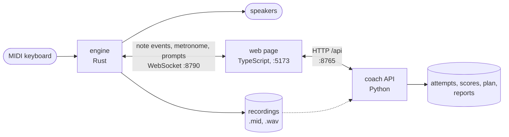

<div align="center">

# rusty_piano

**A low-latency piano engine in Rust, and a practice coach that listens to you play.**


<sub>Replaying a run of Petzold's Minuet in G. Green was right, red was wrong, and the keyboard at the bottom shows what was held.</sub>

[Quick start](#quick-start) · [Features](#features) · [The engine](#the-engine) · [The coach](#the-coach) · [Architecture](#architecture) · [Development](#development) · [Status](#status)

</div>

---

## Why

I'm learning piano on a Studiologic SL990: 88 good keys and no sound at all. It needed something to make the noise, and I needed something to tell me what I'd actually done wrong, because practising alone you only hear that it sounded off.

So rusty_piano is both:

- **an engine** that turns MIDI into piano sound with about 1–2 ms of buffer latency, records every session and streams the notes to a web page;
- **a coach** that shows the sheet music, follows along as you play, saves every attempt and tells you *which* bar you keep rushing, not just a score.

It's built for one beginner (me), but any MIDI keyboard works, and there's a demo mode and a computer-keyboard fallback if you have none.

## Quick start

Windows only for now (the engine talks to Windows audio directly). You need:

- [Rust](https://rustup.rs) with the MSVC toolchain (pinned in `rust-toolchain.toml`)
- [uv](https://docs.astral.sh/uv/) (Python 3.12+ is fetched for you)
- [Node.js](https://nodejs.org) 22.18 or newer (the web tests run TypeScript directly)
- GNU make (`choco install make` works)
- [MSYS2](https://www.msys2.org) with clang, only for the ASIO backend (see [ASIO](#asio-or-not))

```powershell
git clone https://github.com/arch-il/rusty_piano
cd rusty_piano
make install   # Python (uv) and web (npm) dependencies
make dev       # engine in this terminal, coach API + web page in the background
```

Open <http://localhost:5173>. On the very first live start the engine opens a small setup window to pick the MIDI port, the speakers and a sound profile; after that it remembers them in `engine/setup.ron`.

No keyboard? Run `make demo` to hear it, and on the web page the keys `A W S E D F T G Y H U J K` play C4–C5 while no engine is connected (`Z`/`X` shift octaves, Space is the pedal).

### Make targets

| Command | What it runs |
|---|---|
| `make dev` | everything: engine in this terminal, coach API and web page in the background (logs in `.dev-logs/`) |
| `make dev-here` | the same, with all three outputs mixed in one terminal |
| `make setup` | the engine's setup window: MIDI port, audio backend and device, profile, recording, metronome |
| `make engine` / `make demo` | only the engine, live or playing a demo |
| `make api` / `make web` | only the coach API (`:8765`) / only the web page (`:5173`) |
| `make test` | Rust, Python and web tests |

Ctrl+C stops everything, and the engine saves the recording first.

### ASIO or not

The ASIO backend is built by default and needs libclang. The repo expects MSYS2 at `C:\msys64` with `pacman -S mingw-w64-ucrt-x86_64-clang` (set `LIBCLANG_PATH` if yours is elsewhere), and the first build downloads the Steinberg ASIO SDK. To skip all of that, build without it and start the three parts by hand:

```powershell
cd engine; cargo run --release --no-default-features -- --ws-port 8790   # terminal 1
make api                                                                   # terminal 2
make web                                                                   # terminal 3
```

WASAPI shared and WASAPI exclusive still work in that build.

## Features

<table>
<tr>
<td width="50%" valign="top">

<b>Sheet music that follows you.</b> Open your own MusicXML, search about 254,000 public-domain scores from <a href="https://zenodo.org/records/15571083">PDMX</a>, or use the coach's own exercises and all-key scales. <i>Wait</i> mode holds until you hit the right notes; <i>Live</i> mode keeps going and grades your timing.
</td>
<td width="50%" valign="top">

<b>A skill tree with real gates.</b> 77 skills in ten tracks: reading, rhythm, technique, coordination, expression, pedal, harmony, pieces, scales and ear. A skill counts as <i>good</i> after three clean runs on at least two different days, not one lucky take, and <i>mastered</i> only when you can still play it cold after a week away.
</td>
</tr>
<tr>
<td width="50%" valign="top">

<b>An honest practice log.</b> Minutes per day, streaks, every run of every piece, and a replay link for each one.
</td>
<td width="50%" valign="top">

<b>Ear training and sight-reading.</b> Ear training goes from echoing one note to seventh chords and ii–V–I bass lines. Sight-reading goes from five treble notes to two-hand phrases and tracks the notes you miss most.
</td>
</tr>
</table>


**Free play** writes down what you play and names the chords, for noodling or for finding out what that chord you just stumbled on is called.

### Practice tools

- Practise one hand at a time, loop a few bars, and let the **tempo ramp** speed you up a little after every clean pass.
- Fingering suggestions, warnings when you let go of a note too early, and a **Hard bars** button that jumps to where you go wrong most.
- 972 generated **scales and arpeggios** (12 keys, 9 kinds, 1/2/4 octaves, each hand and together) with textbook fingering, graded on how even your notes are.
- Pin a note to a bar or to the whole piece, so next week you remember what the problem was.
- Every session is recorded to `.mid` automatically (optionally `.wav` too). Play it back or render it offline.
- Metronome counted in samples, count-in, transpose and octave shift.

## The engine

`engine/` is Rust. It reads MIDI with `midir` and plays through **WASAPI shared**, **WASAPI exclusive** or **ASIO**.

**Latency.** WASAPI shared gives about 10–20 ms whatever buffer you ask for, which is fine for trying it out. For real playing I use ASIO through [FlexASIO](https://github.com/dechamps/FlexASIO); on my laptop's built-in Realtek speakers that runs clean at a 64-sample buffer, about 1.3 ms at 48 kHz.

**Two voices:**

- a cheap, clean sine-based piano (`default`, `sl990` profiles);
- a **physical-model piano** (`physical`, `physical_sl990`). No samples: every note is computed as you play.

| Part | What's simulated |
|---|---|
| Strings | Stiff, slightly inharmonic strings; one to three per key, tuned a hair apart so they beat like a real unison. |
| Hammer | Nonlinear felt that gets stiffer the harder it hits, simulated at 8× the audio rate. Loud notes are brighter, not only louder. |
| Soundboard | Strings and board push on each other through the bridge; two virtual microphones listen. |
| Resonance | With the pedal down the other strings ring along, as do held keys and the damperless top octave. |
| Noises | Key down and up, hammer knock, pedal. |
| Room | Output EQ and an optional reverb. |

All 88 notes were fitted against reference renders of a Steinway D from Pianoteq. Most of the tuning was done by numbers rather than by ear: the engine renders MIDI offline, measures decay times, brightness and partial levels per note, and compares them with a reference WAV (`--render`, `--fit`, `--fit-check`).

Sounds live in small, commented [RON](https://github.com/ron-rs/ron) files in [`engine/profiles/`](engine/profiles) that **reload while you play**: save the file, hit a key, hear the change.

Rules the engine keeps:

- **The audio thread never waits** — not for the disk, not for the web page. Live events and WAV frames get dropped before the sound is ever delayed.
- **The metronome is counted in samples** on the audio thread, so the click stays in time even when the page lags.
- **A crash costs at most 10 seconds.** Recordings are rewritten every 10 s and on every normal way of stopping.

Flags, backends, profile knobs, the WebSocket protocol and the module map: [`engine/README.md`](engine/README.md).

## The coach

`coach/` is a Python package (the API and CLI) plus a TypeScript web page in `coach/web/` built on [OpenSheetMusicDisplay](https://opensheetmusicdisplay.org).

Every run is saved as its own JSON file and analysed bar by bar: wrong, missed and extra notes, timing, tempo drift and dynamics. The same data is available on the command line (run in `coach/`):

```powershell
uv run coach log                         # minutes per day, streak, pieces worked on
uv run coach analyse --attempt latest    # report on your last run, bar by bar
uv run coach evidence                    # everything added up per drill, piece and bar, plus habits
uv run coach plan link <drill-id>        # a page link that opens a drill with its bars, hands and tempo
uv run coach scores search "fur elise" --piano --difficulty 1-2
```

`coach evidence` also looks for habits across runs, like rests that don't get counted or repeats that get skipped, and `--update-state` writes the skill-tree progress.

**Score sources:** `pdmx` (the public catalogue, ~225 MB index + a one-time 1.9 GB archive), `local` (your own MusicXML), `gen` (238 generated exercises for the skill tree) and `scales`. Set them up from the page's search box or with `coach scores sync <source>`.

**Plan it with an AI.** The practice plan in `coach/data/plan/` — skill tree, progress, habits, piece notes, today's plan and a journal — is plain JSON and Markdown, so you or an AI assistant like Claude Code can read the evidence and write tomorrow's practice. `coach plan check` validates it.

All commands and the HTTP API: [`coach/README.md`](coach/README.md).

## Architecture



- Everything runs locally and listens on `127.0.0.1` only; the API also checks Host and Origin headers.
- The page talks to the engine directly over a WebSocket for note events, metronome beats and ear-training prompts, and to the coach over HTTP for scores, attempts and the plan.
- Your data lives in `coach/data/`, which git ignores (only its READMEs are tracked). The plan folder can be its own git repo so its history is kept.

```
engine/            Rust: MIDI in, sound out, recording, offline render and fit, setup window
  profiles/        sound profiles (RON, live reload)
coach/             Python package: library, analysis, plan, API (`coach serve`)
  web/             TypeScript page (Vite)
  data/            your attempts, sessions, reports, scores and plan (git-ignored)
scripts/dev.ps1    starts the three parts for `make dev`
assets/            screenshots
```

## Development

```powershell
make test                                         # everything
cargo test --manifest-path engine/Cargo.toml      # engine only
uv run --project coach pytest                     # coach only
cd coach/web; node --test tests/*.test.ts         # web only
cd coach/web; npm run build                       # type-check and build the page
```

The engine has a CPU budget test for the physical model (`cargo test --release --test modal_budget -- --nocapture`). Tests that need the private Pianoteq reference renders are skipped without them.

## Status

It works, and it's what I practise with every day. It's also a few weeks old and has met one keyboard and one laptop, so expect rough edges.

- **Size:** about 31k lines of Rust, 26k of Python and 33k of TypeScript (roughly half of the Python and TypeScript is tests), with about 2,800 tests behind `make test`.
- **Windows only**, because of the engine's audio code. The coach and the page are cross-platform; the engine is not (yet).
- **The physical piano isn't finished.** The bass is still darker than the reference and the top notes are close to pure tones.
- **Some numbers are first guesses.** Score difficulty, the evenness grade and habit detection haven't seen much real playing yet.
- **Later, maybe:** a second physical model built on waveguides, more instruments, and importing sheet music from a PDF or a photo.

## Credits and license

- Scores from [PDMX](https://zenodo.org/records/15571083) (Long et al., 2024), CC BY 4.0; each score keeps its own licence and attribution.
- Analysis with [music21](https://web.mit.edu/music21/), fingering with [pianoplayer](https://github.com/marcomusy/pianoplayer), rendering with [OpenSheetMusicDisplay](https://opensheetmusicdisplay.org).
- Most of the code was written with [Claude Code](https://claude.com/claude-code).

[MIT](LICENSE) licensed.
