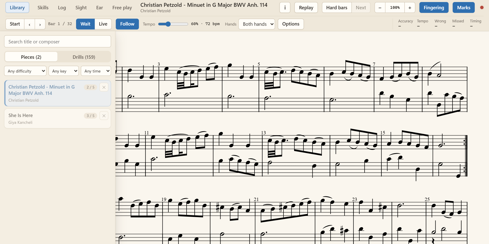
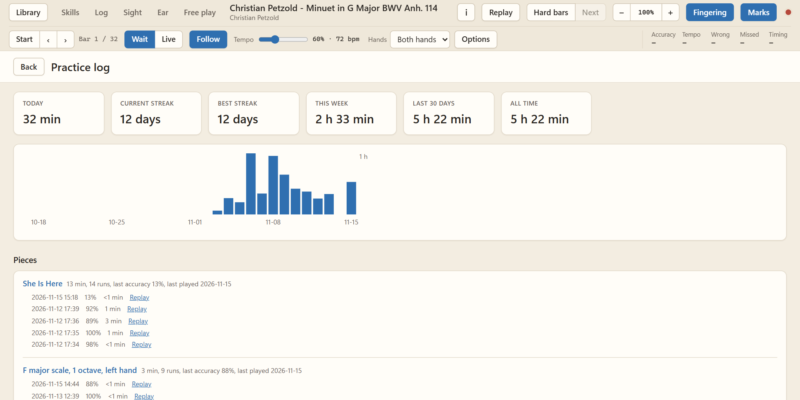
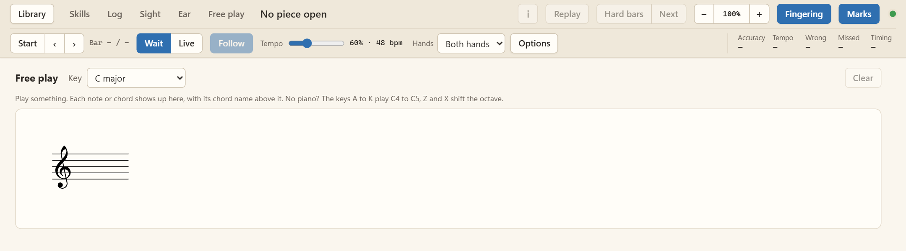

<div align="center">

# rusty_piano

**A piano engine in Rust and a practice coach that actually listens to you play.**


<sub>Replaying a run of Petzold's Minuet in G. Green was right, red was wrong, and the keyboard at the bottom shows what was held.</sub>

</div>

---

I'm learning piano on a Studiologic SL990, which is 88 good keys and no sound at all. It needed something to make the noise, and I needed something to tell me what I'd actually done wrong, since playing alone you just hear that it sounded off.

So I wrote both. The engine turns MIDI into sound with very little delay. The web page shows the sheet music and follows along as I play. The coach saves every attempt, so next time it can tell me *which* bar I keep rushing instead of just giving me a score.

It's built for one beginner (me), but any MIDI keyboard works.

## What it does

<table>
<tr>
<td width="50%" valign="top">

<b>Sheet music that follows you.</b> Open any MusicXML file or grab one from the built-in public-domain library (searchable via <a href="https://zenodo.org/records/15571083">PDMX</a>). <i>Wait</i> mode holds until you hit the right notes; <i>Live</i> mode keeps going and grades your timing.
</td>
<td width="50%" valign="top">

<b>A skill tree with real gates.</b> Reading, rhythm, technique, scales, ear. A skill unlocks after three clean runs on different days, not one lucky take.
</td>
</tr>
<tr>
<td width="50%" valign="top">

<b>A log that doesn't lie.</b> Minutes per day, streaks, every run of every piece, and a replay link for each one.
</td>
<td width="50%" valign="top">

<b>Ear training and sight-reading drills.</b> They go from "echo one note" all the way to seventh chords and ii-V-I bass lines.
</td>
</tr>
</table>



**Free play** just writes down what you play and names the chords. It's handy for noodling, or for finding out what that chord you just found actually is.

### The smaller stuff

- Practice one hand at a time, loop a few bars, and let the **tempo ramp** speed you up a little after every clean pass.
- Fingering suggestions, warnings when you let go of a note too early, and a **Hard bars** button that jumps to where you mess up most.
- Every session gets recorded to `.mid` automatically. You can play it back or render it to WAV.
- A metronome, transpose and octave shift. No keyboard plugged in? Keys `A`–`K` on your computer keyboard play C4–C5.

## The engine

The Rust half reads MIDI with `midir` and plays sound through WASAPI shared, WASAPI exclusive, or ASIO.

There are two voices:

- a cheap, clean sine-based piano
- a **physical-model piano** built from strings, hammers, a soundboard, sympathetic resonance and pedal noise. It's not a sample library.

The sound is set in small, commented [RON](https://github.com/ron-rs/ron) files in [`engine/profiles/`](engine/profiles) that reload while you play. Turn a knob, hit a key, hear it. There's also a small `egui` setup window for choosing the MIDI port, the audio device and a profile.

## Running it

Windows only for now, since the engine talks to Windows audio directly. You'll need [Rust](https://rustup.rs) (MSVC), [uv](https://docs.astral.sh/uv/) and [Node.js](https://nodejs.org).

```bash
make install   # python + web deps
make dev       # engine here, coach API + web page in the background
```

Then open <http://localhost:5173>. No keyboard? `make demo`.

| | |
|---|---|
| `make setup` | setup window: MIDI port, speakers, sound profile |
| `make engine` | just the engine |
| `make api` / `make web` | just the coach API / just the page |
| `make test` | Rust, Python and web tests |

There's more in [`engine/README.md`](engine/README.md) and [`coach/README.md`](coach/README.md).

## How it's wired

```
MIDI keyboard ─▶ engine (Rust) ─▶ speakers
                   ├─▶ recordings (.mid)
                   └─▶ note events over WebSocket
                                │
                     web page (TS) ◀─▶ coach API (Python)
                                           └─▶ attempts, skill tree, plan
```

Everything runs locally. Your recordings and history are plain JSON and Markdown in `coach/data/`, which git ignores, so you (or an AI assistant) can read them and plan the next practice.

```
engine/   Rust: MIDI in, sound out, recording, setup window
coach/    Python API + TypeScript web page (coach/web)
assets/   screenshots
```

---

Most of the code was written with [Claude Code](https://claude.com/claude-code). [MIT](LICENSE) licensed.
