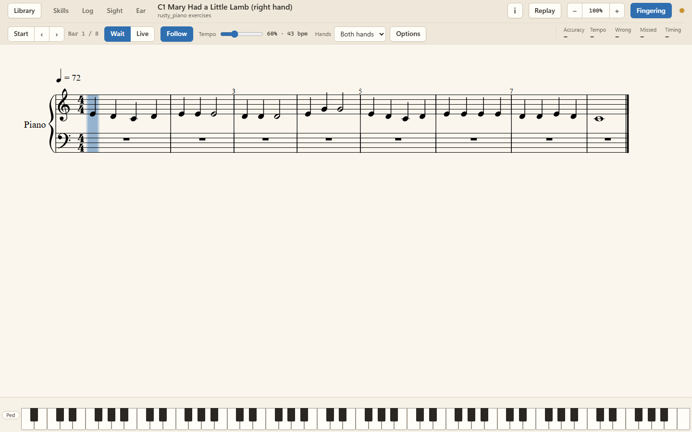
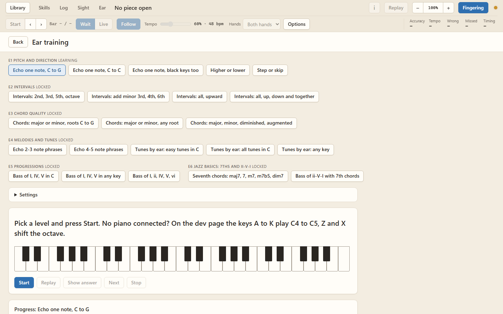

# 🎹 rusty_piano

**A practice room for a beginner pianist: a piano you can tune, and a coach that listens.**

Plug in a MIDI keyboard, open a score in your browser, and play. rusty_piano turns your keystrokes into real piano sound, follows you through the sheet music, and tells you what to fix next, in plain words, the way a good teacher would.



## Why this exists

Learning piano alone is hard in one specific way: nobody tells you *what* you did wrong. You play a piece, it sounds off, and you don't know if it was a wrong note, a rushed bar, or a note you let go of too early.

rusty_piano closes that loop:

1. **Play** on your MIDI keyboard. The engine makes the sound, with very low delay.
2. **Follow** along on the sheet music. Notes light up green, early or late, wrong or missed.
3. **Review** what happened. The coach finds patterns across your sessions and turns them into a short practice plan.
4. **Repeat** tomorrow, with a plan that fits where you are.

It was built for one person learning on a Studiologic SL990 (a USB keyboard with no sound of its own), so the engine and coach are made for each other. It works with any MIDI keyboard.

## What's in the box

### 🔊 A piano engine written in Rust
- Turns MIDI into audio in real time, with WASAPI, ASIO or exclusive-mode output for low latency.
- Two voices: a light sine-based piano, and a **physical-model piano** built from vibrating strings, hammers, a soundboard, sympathetic resonance and pedal noises.
- Sound settings live in small, commented text files (`engine/profiles/`) that reload while you play. They're written so an AI assistant can tune them for you, so you don't need to know what "inharmonicity" is.
- Records every session to `.mid`, plays recordings back, renders offline to WAV, and ships a setup window for picking your MIDI port and speakers.
- Has a transpose / octave shift and a built-in metronome.

### 🎼 A sheet music page that follows you
- Opens MusicXML scores in the browser and draws them with OpenSheetMusicDisplay.
- **Wait mode** pauses until you play the right notes. **Live mode** moves at the tempo and grades your timing.
- Practice a single hand, pick a bar range, loop it, and let the **tempo ramp** speed it up by a few percent after each clean pass.
- Suggests fingerings, and warns when you let go of a note too soon.
- A built-in library of public-domain scores (via the [PDMX](https://zenodo.org/records/15571083) dataset) that you can search, filter by difficulty and key, and download. You can also bring your own files.

### 🧠 A coach that remembers
- Saves every attempt and compares it with the score: wrong, missed and extra notes, timing, dynamics, held notes.
- Keeps a **skill tree** with honest gates, so "I've got this" means three clean runs on different days, not one lucky take.
- Tracks habits (rushing, ignoring rests, skipping repeats), your streak, and minutes practiced.
- **Sight-reading** and **ear training** drills, plus a replay view that shows a past attempt note by note.
- Everything is stored as plain JSON and Markdown on your own disk, so you, or an AI assistant such as [Claude Code](https://claude.com/claude-code), can read your history and plan what to practise next.



## Quick start

> Windows is the supported platform today. The engine uses Windows audio and MIDI APIs.

You need [Rust](https://rustup.rs) (MSVC toolchain), [uv](https://docs.astral.sh/uv/) for Python, and [Node.js](https://nodejs.org).

```bash
make install     # Python and web dependencies
make dev         # engine in this window, coach API and web page in the background
```

Then open <http://localhost:5173>.

No keyboard handy? Run the engine in demo mode with `make demo`. The page also has a computer-keyboard fallback for trying things out.

Other useful commands:

| Command | What it does |
|---|---|
| `make setup` | Opens the setup window (MIDI port, speakers, sound profile) |
| `make engine` | Runs the engine alone |
| `make api` / `make web` | Runs the coach API or the page alone |
| `make test` | Runs the Rust, Python and web tests |

More detail lives in [`engine/README.md`](engine/README.md) and [`coach/README.md`](coach/README.md).

## How it fits together

```
 MIDI keyboard ──▶ engine (Rust) ──▶ speakers
                      │
                      ├──▶ session recordings (.mid)
                      └──▶ live note events (WebSocket)
                                   │
                                   ▼
                    web page (TypeScript) ◀──▶ coach API (Python)
                                                   │
                                                   ▼
                              reports · skill tree · practice plan
```

The whole thing runs on your own machine. Nothing is sent anywhere, and your recordings and practice history stay in your own `coach/data/` folder, which git ignores.

## A note on how it was built

Most of this project was written together with [Claude Code](https://claude.com/claude-code).

## Project layout

```
engine/    Rust: MIDI in, piano sound out, recording, setup window
coach/     Python API and library, plus the TypeScript web page (coach/web)
assets/    Screenshots for this README
```

## License

[MIT](LICENSE). Use it, change it, learn from it.
